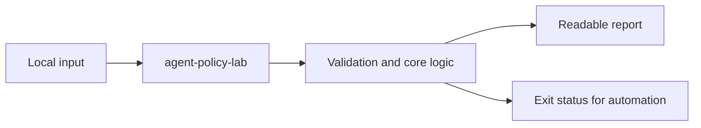

# agent-policy-lab

<div align="center">
  
  <br/>
  
  
  
</div>

> A local-first policy engine for approving, reviewing, or denying AI-agent tool actions before execution.

## Why it exists

A focused, inspectable starter for a real developer workflow. It favors explicit behavior, local execution, and small pieces that are easy to understand and extend.

## Features

- Allow, deny, and human-review rules with wildcard matching
- Default-deny mode and machine-readable JSON decisions
- JSONL audit output with no network calls
- Small, auditable policy format

## Architecture



## Requirements

- Python 3.10+ / standard library
- A terminal and a local checkout of this repository

## Quick start

```bash
python src/agent_policy.py --policy examples/policy.json --action read_file
```

## Example

```bash
echo '{"tool":"read_file","arguments":{"path":"README.md"}}' | python src/agent_policy.py --policy examples/policy.json --action read_file
```

## Project status and limitations

This repository contains an initial working implementation, not a production-certified product. Review the source and test it against your own fixtures before adopting it in critical workflows.

The engine is deliberately a decision point, not an executor. Your application must enforce the returned decision before calling a tool.

## Roadmap

- [ ] Add policy composition and rule priorities
- [ ] Add signed policy bundles
- [ ] Add adapters for common agent runtimes

## Contributing

Issues and pull requests are welcome. Please include a small reproducible example for bug reports, keep changes focused, and add tests for new behavior. Do not submit secrets, private data, or generated artifacts.

## License

MIT. See [LICENSE](LICENSE). Third-party services or optional dependencies remain subject to their own terms.
